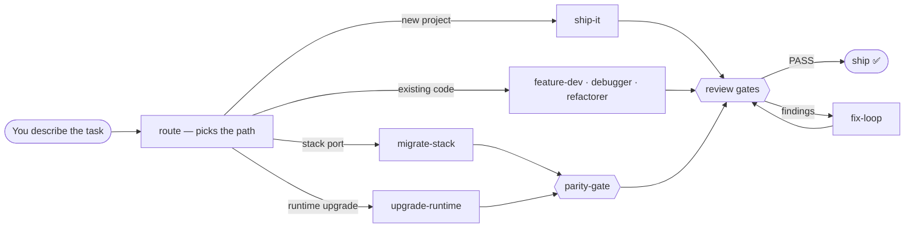

<div align="center">

# 🤖 sdlc-agents

**A full software-delivery crew for Claude Code — 29 specialist agents, 6 review gates, one quality bar.**

Design → build → review → ship → document. New projects, existing code, cross-stack migrations, and runtime upgrades.

[](https://github.com/harish-soni-swarnkar/sdlc-agents/actions/workflows/ci.yml)
[](LICENSE)
[](#-quick-start)
[](portable/README.md)


**Portable edition for:**


[Quick start](#-quick-start) · [How it works](#-how-it-works) · [The crew](#-the-crew) · [Gates](#-review-gates) · [Guardrails](#-guardrails-that-actually-enforce) · [Portable edition](#-portable-edition)

</div>

---

## ✨ Why sdlc-agents

- **🎯 One quality bar, everywhere** — every agent verifies by running, cites evidence (`file:line`, a repro, a number), and refuses to hallucinate, overcommit, or bypass a failing check.
- **🚦 Gates, not hope** — six read-only review gates merge several expert lenses into one verdict. A gate can't edit your code, so it can't quietly make itself pass.
- **🧭 All four lifecycles** — new projects, changes to existing code, cross-stack migrations (e.g. Java → Node) with *proven* behavioral parity, and runtime upgrades (e.g. Node 18 → 22).
- **🛡️ Enforced, not just advised** — hooks block secret reads, force-pushes, destructive commands, and edits to existing migrations. Git hooks carry that safety into any tool.
- **🌍 Two editions, one source** — a native Claude Code plugin, plus a portable set of 30 standard SKILL.md skills for Codex, Cursor, Copilot, Gemini CLI and more — generated from the same agents.

---

## ⚡ Quick start

**Claude Code — as a plugin** *(recommended)* — inside Claude Code:

```text
/plugin marketplace add harish-soni-swarnkar/sdlc-agents
/plugin install sdlc-agents@sdlc-agents
```

Update later with `/plugin marketplace update sdlc-agents`. To try it without installing:
`claude --plugin-dir ./sdlc-agents` (one session only).

**Claude Code — manual install** *(solo, no plugin)*

```bash
git clone https://github.com/harish-soni-swarnkar/sdlc-agents && ./sdlc-agents/install.sh
```

**Codex, Cursor, GitHub Copilot, Gemini CLI, …** *(portable edition)*

```bash
npx skills add harish-soni-swarnkar/sdlc-agents/portable
```

**Then just describe the work.** Not sure which agent fits? Start with `route`:

```text
/sdlc-agents:start Add rate limiting to our public API
```

`route` classifies the task, picks the agents, orders them, sizes the gating to the risk, and runs the sequence on your go. (Manual install: *"Use the route agent. …"* — portable: *"use the route skill"*.)

---

## 🧩 How it works



**Gates are read-only; pipelines and loops write.** That separation is the point — reviewers can't change what they review.

---

## 🧭 Pick your path

| You want to… | Command (plugin) | What runs |
|---|---|---|
| 🆕 **Start a new project** | `/sdlc-agents:new-project <brief>` | `ship-it`: architect → builder → review-gate → sre → tech-writer |
| ✏️ **Change existing code** | `/sdlc-agents:feature <change>` | `onboard` (if unmapped) → `feature-dev`, self-gated |
| 🐛 **Fix a bug** | `/sdlc-agents:fix <symptom>` | `debugger` (root cause + regression test) → `pr-ready` |
| 🔀 **Port to another stack** | `/sdlc-agents:migrate <src> to <target>` | `migrate-stack`: golden baseline → strangler-fig port → `parity-gate` |
| ⬆️ **Upgrade a runtime** | `/sdlc-agents:upgrade <version>` | `upgrade-runtime`: baseline → lockstep bumps → deprecation sweep → `parity-gate` |
| 🔍 **Review code** | `/sdlc-agents:review [target]` | `review-gate` → `fix-loop` on request |
| 🚀 **Release** | `/sdlc-agents:release [target]` | `production-gate` → `fix-loop` on request |
| 🤔 **Not sure** | `/sdlc-agents:start <task>` | `route` plans it, then runs it on your go |

---

## 👥 The crew

### 🏗️ Build & fix

| Agent | What it does |
|---|---|
| **senior-architect** | Shapes the problem before code: requirements, trade-offs, design, ADRs, scale |
| **senior-builder** | Builds a **new** app from a brief to the full bar — tested, documented |
| **feature-dev** | Changes **existing** code with the smallest idiomatic diff |
| **debugger** | Root-causes a bug / crash / flaky test, fixes it, adds a regression test |
| **refactorer** | Pays down debt and runs upgrades — behavior-preserving |
| **onboard** | Maps an unfamiliar repo before anyone edits it (writes `ARCHITECTURE.md`) |

### 🔬 Review & quality

| Agent | What it does |
|---|---|
| **senior-auditor** | Code-quality, design, and SDLC review — strictly read-only |
| **security-reviewer** | STRIDE, OWASP, authz, secrets, supply chain (CVEs, licenses) — strictly read-only |
| **qa-test-engineer** | Adversarial testing: edge cases, concurrency, crash/resume, golden baselines |
| **performance-engineer** | Latency, bottlenecks, memory leaks, N+1 — measures before optimizing |
| **accessibility** | WCAG 2.2 AA: keyboard, screen reader, contrast, focus, motion |

### ⚙️ Domain & platform

| Agent | What it does |
|---|---|
| **data-engineer** | Schema, zero-downtime migrations with rollbacks, query tuning, cross-stack data traps |
| **compliance-privacy** | GDPR / DPDP / CCPA / HIPAA / PCI: PII, consent, retention, rights (advisory) |
| **finops-cost** | Cloud spend: right-sizing, waste, commitments, guardrails |
| **release-devops** | CI/CD, release strategy, tested rollback, IaC, Dependabot/Renovate |
| **sre-reliability** | Observability, SLOs, runbooks, deploy/rollback, recovery |
| **tech-writer** | README, HLD/LLD, decisions, API docs, and the extend-me handover doc |

### 🔁 Pipelines & loops

| Agent | Chains |
|---|---|
| **ship-it** | architect → builder → review-gate → sre → tech-writer |
| **takehome-runner** | ship-it, tuned for graded exercises and their deliverables |
| **fix-loop** | review-gate → fixes → re-gate, until it passes (bounded) |
| **migrate-stack** | baseline → target design → strangler-fig port → parity → gate |
| **upgrade-runtime** | dependency audit → baseline → lockstep bumps → deprecations → parity → CI |
| **route** | the entry point — plans the workflow and sizes the gating to the risk |

---

## 🚦 Review gates

Read-only, each with one verdict. Pick by weight — **`route` does this for you**: a small change gets the fast lane, anything touching auth, data, APIs, infra, or a release gets the full pipeline.

| Gate | Lenses | Verdict |
|---|---|---|
| ⚡ **pr-ready** | auditor + QA, diff only — the fast lane | READY / NOT-READY |
| 🔍 **review-gate** | auditor + security + QA (+ data / accessibility when relevant) | PASS / CONDITIONAL / FAIL |
| 📐 **design-gate** | architect + security, before any code | PROCEED / REVISE |
| 🛫 **hardening-gate** | security + SRE (+ release / compliance / cost) for go-live | GO / NO-GO |
| 🏁 **production-gate** | the full battery **plus proof** that tests, coverage, scans, and CI pass | READY / NOT-READY |
| ⚖️ **parity-gate** | the same golden suite against old **and** new — mechanical diffs only | PARITY-HELD / DIVERGENCES-FOUND |

---

## 🔒 Guardrails that actually enforce

Prompts are advisory. These run whether or not the model "remembers":

| Layer | Blocks | Where it works |
|---|---|---|
| **Plugin hooks** | reading or printing secrets · force-push · recursive `rm` on `/` or `~` · `DROP`/`TRUNCATE` · editing an existing migration or lockfile | Claude Code |
| **Git hooks** | committing secret files or keys · editing an existing migration · force-push | **Any tool** — git runs them |
| **Permissions deny-list** *(recommended)* | Read/Grep/shell access to `.env*`, keys, `secrets/` | Claude Code |

Plus a stack-aware `verify.sh` (Node, Python, Java, Go, Rust — even side by side mid-migration) that can block "done" until tests pass, and a session-start snapshot that spots a Java + Node repo as a likely migration. Details: [`templates/README.md`](templates/README.md).

---

## 🧠 The standing bar

Every agent holds the same line:

- ✅ **Verify by running** — claim only what was executed; paste real output
- 🚫 **No hallucination · no overcommit · no bypassing** — fix root causes, never stub or loosen a check to look green
- 📎 **Evidence** — `file:line`, a repro, or a number, with a confidence tag
- 🩺 **Baseline first** — check the untouched build and tests *before* changing anything, so old failures are never blamed on new code
- ✋ **Ask before anything irreversible**

And three code-generation rules for **every language**: **context anchoring** (verify every API exists before using it), **strict typing** at every boundary, and **test-first** verification.

---

## 🌍 Portable edition

The same crew as **30 standard SKILL.md skills** ([agentskills.io](https://agentskills.io)) plus an `AGENTS.md`, for Codex, Cursor, GitHub Copilot, Gemini CLI, Antigravity and other Agent Skills tools:

```bash
npx skills add harish-soni-swarnkar/sdlc-agents/portable
```

Generated from the Claude Code agents by `portable/build.py`, so the two editions never drift. Includes a golden-replay harness for parity work and git hooks for enforcement. See [what's different](portable/README.md#whats-different-from-the-claude-code-edition) and the [full guide](portable/README.md).

---

## 🧰 Per-project kit

`templates/setup-project.sh [--standalone] [--git-hooks] [project-dir]` drops a project-level layer into any repo, without overwriting what's there:

- **Hooks & settings** — deny-list, guards, formatter, opt-in test gate (plugin-companion or standalone)
- **Golden-replay harness** — record an API's responses, replay against the new system, diff
- **Git hooks** — commit/push safety for every tool (respects an existing Husky / Lefthook setup)
- **Path-scoped rules** — TS/JS, Java, Python, Go conventions that load only for matching files
- **`.mcp.json`** — pinned context7 (live library docs) + Playwright (real browser checks)

---

## 🧪 Quality & status

**Tested:** 79 hook guard cases · 13 git-hook cases against scratch repos (including a real force-push to a local remote) · an end-to-end replay-harness test against two local servers · strict-YAML checks on all 72 frontmatter blocks · a spec validator for the portable edition (proven to catch a deliberately broken copy) · the official `skills-ref` Agent Skills validator and `claude plugin validate . --strict`, both passing in CI.

**Honest caveats:** one agent (`senior-auditor`) has been smoke-tested end-to-end on a real repo; the other 28 are authored and structurally validated but not each run live. The hooks and slash commands haven't been exercised in a live Claude Code session yet.

<details>
<summary><b>More detail — model routing, coverage map, how it's built</b></summary>

### Model routing

Each agent pins a model so behavior is predictable regardless of the session default:

- **`opus`** (12) — judgment-critical: senior-architect, senior-builder, feature-dev, debugger, refactorer, senior-auditor, security-reviewer, qa-test-engineer, performance-engineer, data-engineer, migrate-stack, upgrade-runtime
- **`sonnet`** (17) — orchestration, advisory, ops, docs: route, onboard, all 6 gates, ship-it, takehome-runner, fix-loop, sre-reliability, release-devops, tech-writer, compliance-privacy, accessibility, finops-cost

`effort: high` on senior-architect, senior-auditor, migrate-stack. `memory: project` on senior-architect and onboard, so they keep decisions and repo maps across sessions.

### Coverage map

| Check | Owner |
|---|---|
| Security / vulnerabilities | `security-reviewer` |
| Supply chain / Dependabot | `security-reviewer` flags · `release-devops` configures · `production-gate` verifies |
| Race conditions | `qa-test-engineer` + `senior-auditor` |
| Performance / memory leaks | `performance-engineer` |
| Database / migrations / queries | `data-engineer` |
| Accessibility | `accessibility` |
| Privacy / compliance | `compliance-privacy` |
| Cloud cost | `finops-cost` |
| CI/CD · release · rollback · IaC | `release-devops` |
| Unit / integration / e2e tests | `senior-builder` / `feature-dev` write · `qa-test-engineer` extends |
| Coverage · build · lint · typecheck · CI | `production-gate` verifies by running |
| Production readiness | `sre-reliability` + `hardening-gate` + `production-gate` |

### Repo layout

| Path | What's there |
|---|---|
| `agents/` | the 29 agents — the single source of truth |
| `skills/` | 8 plugin slash commands + the `engineering-rules` skill |
| `hooks/` | plugin hooks (`hooks.json`) and their scripts |
| `templates/` | the per-project kit: settings, harness, git hooks, rules, ledger skeletons |
| `portable/` | the generated cross-tool edition (`build.py`, `validate.py`, `install.sh`) |
| `global/CLAUDE.md` | the always-on rules `install.sh` deploys to `~/.claude/CLAUDE.md` |
| `tests/` | hook, git-hook, harness, and frontmatter tests (all run in CI) |

### Releasing

`./release.sh` builds a zip from a clean, committed tree only — after the hook, git-hook, harness, frontmatter, and portable checks, and `claude plugin validate . --strict` (it refuses without the CLI unless you pass `--skip-validate`). It packages with `git archive`, so local files never leak.

</details>

---

<div align="center">

**MIT licensed** · Built by [Harish Soni Swarnkar](https://github.com/harish-soni-swarnkar)

If this saves you time, a ⭐ helps others find it.

</div>
